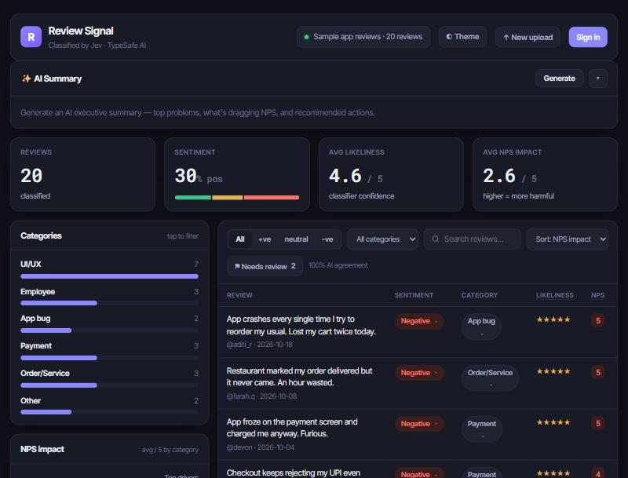

# Review Signal

**Turn a spreadsheet of customer reviews into a decision-ready dashboard — in seconds.**

Upload a CSV of reviews and every row is classified for **sentiment**, **category**, **classifier confidence**, **NPS impact**, and whether it contains **actionable feedback** — then opened in an editable dashboard with an AI-written executive summary.

🔗 **Live demo:** https://review-signal-three.vercel.app · 🧪 Try it with the built-in sample dataset (no sign-up needed)



---

## What it does

- **Classifies every review** — sentiment (positive / neutral / negative), one of six categories (UI/UX, Employee, App bug, Payment, Order/Service, Other), a 1–5 confidence score, a 1–5 NPS-impact rating, and a Yes/No "actionable feedback" flag.
- **AI executive summary** — one click turns the whole dataset into a headline, top problems, NPS drivers, and recommended actions.
- **Editable dashboard** — KPI tiles, a clickable sentiment bar, a category breakdown, an NPS-impact chart, a sentiment-over-time trend, and a filterable/sortable table where every label is editable.
- **Low-confidence queue** — surfaces the reviews the AI was least sure about, and clears them as you correct them, with a live "AI agreement" metric.
- **Accounts & history** — optional sign-in saves your datasets (per-user, with row-level security); guests work fully without an account.
- **Export** — download a clean, classified CSV.

## Tech stack

| Layer | Choice |
|---|---|
| **Classifier** | **Jev (TypeSafe AI)** — a fast typed-decision model — with an offline keyword fallback |
| **AI summary** | **OpenAI** (dataset-level only) |
| **Backend** | Node.js + Express |
| **Auth & DB** | **Supabase** (Postgres + Auth + Row-Level Security) |
| **Frontend** | Vanilla JS + CSS (no framework, no build step) |
| **Hosting** | **Vercel** serverless |
| **Tests** | Node's built-in test runner |

## How it works

```
Browser ──► POST /api/datasets/prepare   (parse CSV, auto-detect the review column)
        ──► POST /api/classify  × N       (classify in 20-row batches, 3 in parallel)
        ──► POST /api/datasets/commit      (persist to Supabase if signed in)
        ──► POST /api/insights             (OpenAI summary, on demand)
```

**A few deliberate design decisions:**

- **Client-batched classification.** Serverless functions have a hard timeout (~10s on Vercel Hobby). Classifying a whole sheet in one request would blow past it, so the browser splits the work into small batches and shows a live progress counter. Each request stays tiny; any size of file works.
- **Stateless by design.** Guest state lives in the browser (export is generated client-side); signed-in state lives in Supabase. Nothing depends on server memory between requests — which is exactly what serverless needs.
- **Division of labour between two AIs.** Jev does the cheap, fast per-row classification it's built for; OpenAI only writes the one dataset-level summary where a general LLM adds value. Best tool for each job.
- **Row-Level Security over app-layer checks.** Every `datasets`/`reviews` row is scoped to its owner in Postgres, so a user can never read another's data even if the API had a bug.
- **Graceful degradation.** No Jev key → offline classifier. No OpenAI key → the summary card hides. No Supabase → guest-only. The app always runs.

## Run it locally

```bash
npm install
npm start           # http://localhost:3000
npm test            # run the unit tests
```

It runs with **zero configuration** (offline classifier + CSV upload). To enable the rest, copy `.env.example` to `.env` and fill in what you want:

```bash
CLASSIFIER=jev
TYPESAFE_API_KEY=...          # Jev classifier
OPENAI_API_KEY=...            # AI Summary
SUPABASE_URL=...              # accounts + saved datasets
SUPABASE_ANON_KEY=...
SUPABASE_SERVICE_ROLE_KEY=...
```

For accounts, run [`supabase/schema.sql`](supabase/schema.sql) in your Supabase SQL editor (creates the tables + RLS policies).

## Project layout

```
src/
  server.js            Express app (also the Vercel serverless entry via api/index.js)
  config.js            env-driven configuration
  classifiers/         Jev adapter, offline mock, shared schema
  lib/                 CSV parsing, Supabase client, auth, rate limiting, OpenAI insights
  routes/api.js        REST API
  sheets/              Google Sheets read/write (optional)
public/                landing page + dashboard (vanilla JS)
supabase/schema.sql    database schema + RLS
test/                  unit tests
```

## Notes & scope

This is a **portfolio project**, built to demonstrate a full-stack AI feature end to end. A few things are intentionally scoped for that:

- The per-IP rate limiting on the paid endpoints is best-effort (in-memory); production would use a shared store or auth-gate them.
- Classification accuracy isn't formally evaluated — the "AI agreement" metric is a lightweight proxy.
- Sentiment is inferred from review text; an explicit star-rating column, if present, is not used as ground truth.

## License

[MIT](LICENSE)
